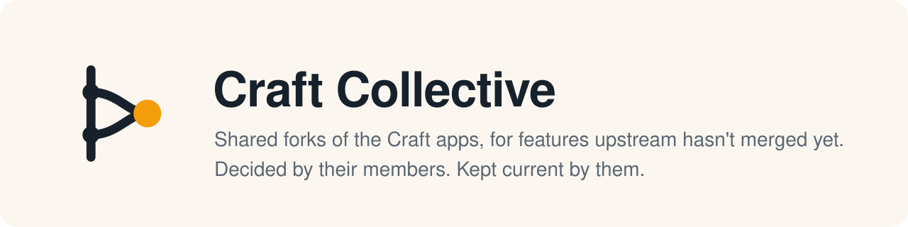

Lots of good work on the [storytold](https://github.com/storytold) Craft apps sits in open pull requests, and the same feature is often written several times by different people. A **Craft Collective fork** gives one such feature a single home:
- **A goal, written down** and adopted by vote, with its open questions settled the same way.
- **One branch per repository**, in this org's copies of the apps.
- **Shared upkeep:** members review each other's patches and take turns rebasing the fork onto upstream every Monday.

Nobody here is a gatekeeper. Members decide in PR comments, and [a bot](https://github.com/craft-collective/pilot/tree/main/scripts) carries out what passes.

### The forks

| Fork | What it is |
|---|---|
| [`web-host`](https://github.com/craft-collective/pilot/tree/main/forks/web-host/adr) | VectorCraft's web build, embeddable by other pages: a host bridge, host storage, a smaller first download, and fonts and materials supplied by the host |
| [`pbr-engine`](https://github.com/craft-collective/pilot/tree/main/forks/pbr-engine/adr) | EffectCraft's PBR engine, extracted into craft-libs for every app to use |
| [`pbr-vectorcraft`](https://github.com/craft-collective/pilot/tree/main/forks/pbr-vectorcraft/adr) · [`pbr-deckcraft`](https://github.com/craft-collective/pilot/tree/main/forks/pbr-deckcraft/adr) · [`pbr-photocraft`](https://github.com/craft-collective/pilot/tree/main/forks/pbr-photocraft/adr) | The apps' 3D features, built on that shared engine |

### Start here

- **People:** [how it works](https://github.com/craft-collective/pilot/blob/main/PROCESS.md)
- **Agents:** [AGENTS.md](https://github.com/craft-collective/pilot/blob/main/AGENTS.md)
- **Using a fork:** clone this org's copy of the app, then `git switch fork/<name>`.

This is a pilot of [Collective](https://collective.software)'s forks, run by hand on GitHub. It is in its solo phase while the whole cycle gets tried end to end, so joining opens soon.
